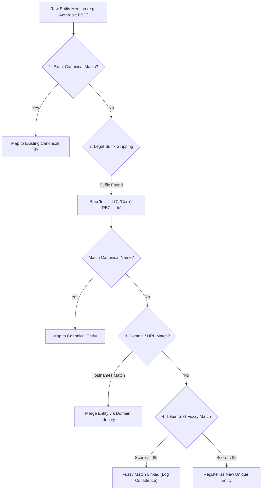

# FrontierAtlas AI — Data Pipeline & Ingestion Engine Specification

## 1. Overview & Data Flow

The **FrontierAtlas AI** data pipeline is an automated, fault-tolerant ingestion engine designed to harvest unstructured, semi-structured, and structured data across the global artificial intelligence landscape. The pipeline enforces strict data provenance, cryptographic deduplication, rigorous schema validation, and deterministic entity resolution.

```
[Raw Sources: Startups, Products, ArXiv, GitHub, Jobs, RSS]
                           │
                           ▼
          [Asynchronous Ingestion Engine]
         (aiohttp concurrent session pool)
                           │
                           ▼
          [Deterministic Semantic Chunker]
       (Splits long text into <4KB boundaries)
                           │
                           ▼
          [LLM Extraction & Fallback Chain]
  (Gemini 1.5 Pro ➔ Flash ➔ Claude ➔ GPT-4o ➔ DLQ)
                           │
                           ▼
          [Pydantic v2 Schema Validator]
      (Strict type checking, field validation)
                           │
                           ▼
          [Normalization & Freshness Gate]
 (URL canonicalization, ISO-8601, 24-hr verification)
                           │
                           ▼
       [Deterministic Entity Resolution Cascade]
 (Exact Match ➔ Legal Suffix Strip ➔ Fuzzy Token Sort)
                           │
                           ▼
    [Relational Storage & Knowledge Graph Builder]
  (SQLite / PostgreSQL ACID Transactions + Exporters)
```

---

## 2. Ingestion Sources & Protocols

| Entity Category | Primary Protocol | Target Domains / Sources | Extraction Strategy |
| :--- | :--- | :--- | :--- |
| **AI Startups** | HTTP/REST + DOM | Specialized directories, startup registries, funding feeds | Structured JSON parsing + DOM CSS selectors for team size, valuation, funding stage, and core capability. |
| **AI Products** | HTTP/JSON + DOM | Product discovery platforms, developer directories | Extraction of target audience, pricing models (`Free`, `Freemium`, `Paid`, `Enterprise`, `Open Source`), and launch dates. |
| **Research Papers** | OAI-PMH / XML Feed | ArXiv API (`cs.AI`, `cs.LG`, `cs.CL`, `cs.CV`) | Title, authors list, abstract, published date, primary category, and extraction of associated GitHub repositories. |
| **GitHub Repos** | GitHub REST API v3 | `api.github.com/repos/{owner}/{repo}` | Authentic star counts, forks, primary language, and open issue metrics. Differentiates papers with vs without code. |
| **AI Jobs** | RSS / JSON Feeds | Specialized AI tech boards, remote engineering feeds | Role title, hiring company, location, remote classification, salary range, and strict publication timestamp. |
| **Industry News** | RSS / Atom Feeds | VentureBeat AI, TechCrunch AI, MIT Tech Review, ArXiv | Headline, publication time, source outlet, summary, sentiment classification, and entity mentions. |

---

## 3. Resilience, Rate Limiting & Fallback Mechanisms

### 3.1 413 Payload Chunking Engine
Large documents and research papers can exceed context window limits or cause HTTP 413 Payload Too Large responses. The `SemanticChunker` (`src/crawlers/chunking.py`) splits long text using markdown headings and semantic paragraph boundaries into deterministic chunks of $\le 4,000$ characters, maintaining a 200-character overlapping sliding window. Chunk extractions are reconciled using confidence-weighted entity merging.

### 3.2 429 Jittered Exponential Backoff
External LLM APIs and web scrapers encounter rate limiting (HTTP 429). The pipeline implements full jitter exponential backoff:

$$T_{\text{wait}} = \min(T_{\text{max}},\, T_{\text{base}} \times 2^{\text{attempt}}) + \text{random}(0, \text{jitter})$$

This prevents the "thundering herd" problem across concurrent crawler workers.

### 3.3 Hierarchical LLM Fallback Succession
When extracting entities from semi-structured web content, the LLM service executes a tiered succession chain:
1. **Primary:** Google Gemini 1.5 Pro (Deep structured extraction)
2. **Secondary:** Google Gemini 1.5 Flash (Low latency, high throughput)
3. **Tertiary:** Anthropic Claude 3.5 Sonnet (Complex reasoning fallback)
4. **Quaternary:** OpenAI GPT-4o (Generalist completion fallback)
5. **Final Fallback:** Mistral Large
6. **Failure Guard:** If all providers fail or quotas are exhausted, the extraction payload is safely diverted to the `Dead Letter Queue (DLQ)` (`data/dlq/`) for manual review and replay, ensuring zero unhandled pipeline crashes.

---

## 4. Entity Resolution & Deduplication Cascade

A central challenge in intelligence ingestion is reconciling diverse mentions of the same company or product (e.g., *"OpenAI LLC"*, *"OpenAI, Inc."*, *"openai"*). FrontierAtlas AI applies a 4-tier deterministic resolution cascade (`src/normalization/entity_resolution.py`):



### Deterministic Resolution Rules:
1. **Case-Insensitive Canonical Lookup:** Direct normalization against registered company aliases.
2. **Legal Suffix Sanitization:** RegEx-based removal of corporate designations (`Inc`, `Inc.`, `LLC`, `Corp`, `Corporation`, `PBC`, `Ltd`, `GmbH`, `AG`).
3. **FQDN Domain Matching:** Stripping schemes (`https://`), paths, and query strings to isolate the root domain (e.g., `openai.com`). Entities sharing identical validated root domains are collapsed into a single canonical record.
4. **Fuzzy Token-Sort Ratio:** Comparing word tokens irrespective of order using Levenshtein distance:
   $$\text{Ratio} = \frac{2 \times M}{T_1 + T_2} \ge 0.85$$
   Matches between 85% and 99% are logged in `data/exports/entity_mapping_log.csv` with source text, canonical mapping, and confidence scores for full auditability.

---

## 5. Strict Freshness & Provenance Guarantees

- **Provenance:** Every startup, product, research paper, job, and news item retains its original `source_url`, `crawled_at` timestamp, and extraction `confidence_score`.
- **Strict 24-Hour Window Verification:** Job opportunities and news stories undergo validation checking publication timestamps against a 24-hour delta window during ingestion to eliminate stale signals. Historical assessment records retain exact collection metadata.
- **Deduplication Fingerprinting:** Every raw document is hashed using SHA-256 over its canonical payload `(title + source_url + published_date)`. Duplicate hashes are skipped prior to LLM extraction, eliminating redundant API compute costs.
